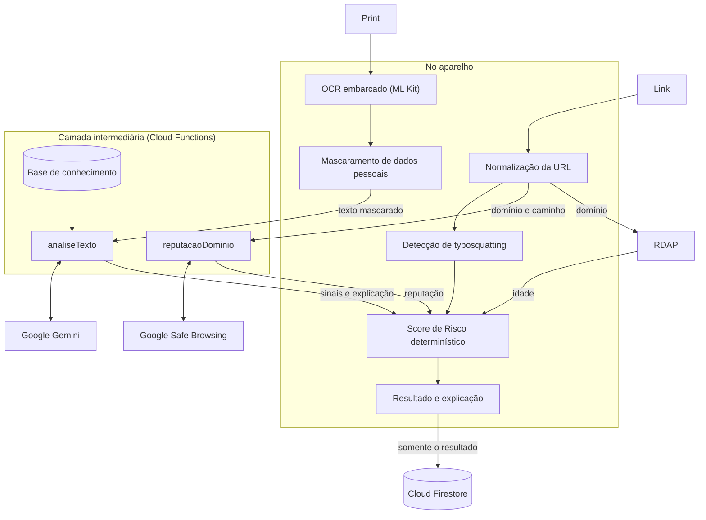

# Phize

**Recebeu uma mensagem ou um link estranho? Confira antes de clicar.**

O Phize é um aplicativo de segurança preventiva e educação digital. Ele analisa links e prints de conversas, aponta sinais de golpe e explica, em linguagem simples, o que chamou a atenção e o que fazer em seguida.


> [!IMPORTANT]
> Projeto acadêmico em desenvolvimento, sem publicação em loja. A versão atual usa a camada gratuita do Google Gemini e **só deve receber conteúdo fictício**: não envie conversas nem dados pessoais reais. Veja [Limitações](#limitações).

## Sumário

- [O que o app faz](#o-que-o-app-faz)
- [Como funciona](#como-funciona)
- [Privacidade](#privacidade)
- [Tecnologias](#tecnologias)
- [Como rodar](#como-rodar)
- [Testes](#testes)
- [Estrutura do projeto](#estrutura-do-projeto)
- [Documentação](#documentação)
- [Limitações](#limitações)
- [Equipe](#equipe)
- [Licença](#licença)

## O que o app faz

| Área | Funcionalidades |
| --- | --- |
| **Análise de link** | Reputação no Google Safe Browsing, idade do domínio (RDAP) e detecção de endereços que imitam marcas conhecidas (typosquatting) |
| **Análise de print** | Leitura do texto no próprio aparelho, identificação de sinais de golpe, destaque das frases suspeitas e explicação pedagógica |
| **Compartilhamento nativo** | No Android, o link ou o print pode ser enviado direto de outro app, como o WhatsApp, para o Phize |
| **Histórico** | Guarda o resultado das análises, nunca o conteúdo analisado |
| **Comunidade** | Reporte de golpes, feed, curtidas, pesquisa, denúncia, moderação e gestão dos próprios reportes |
| **Educação** | Tutorial interativo, "Golpe da semana" e tela que explica como o risco é calculado |
| **Conta** | Cadastro por e-mail ou Google, perfil, tamanho da letra, exportação dos dados e exclusão da conta |

Todo resultado usa uma escala de três faixas:

| Faixa | Rótulo exibido |
| --- | --- |
| 🟢 Baixo risco | "Não encontramos sinais de golpe" |
| 🟡 Risco médio | "Atenção: sinais suspeitos" |
| 🔴 Alto risco | "Alto risco de golpe" |

O Phize nunca afirma que um conteúdo está livre de risco. A análise é uma ferramenta de apoio à decisão e não substitui a verificação direta com a instituição envolvida.

## Como funciona



Três decisões orientam o projeto:

- **O modelo de linguagem não calcula o risco.** Ele identifica sinais e escreve a explicação. O score, de 0 a 100, sai de uma função determinística com pesos versionados: os mesmos sinais sempre produzem o mesmo número. Os valores ficam em [`docs/score-calibracao.md`](docs/score-calibracao.md).
- **A análise de print é fundamentada (RAG).** Antes de responder, o modelo recebe os padrões mais parecidos de uma [base curada de golpes brasileiros](functions/base-conhecimento/README.md), formada por 21 fichas revisadas pela equipe e por reportes da comunidade incluídos pela moderação.
- **O app diz o que não conseguiu verificar.** Se uma fonte falha, o resultado sai com os sinais disponíveis e informa qual verificação ficou incompleta; nesse caso, a faixa verde é elevada para amarela. Sem resposta do modelo de linguagem, não há sinais para avaliar um print, e o app avisa que a análise não foi concluída.

## Privacidade

- **A imagem não sai do aparelho.** O OCR é embarcado, e o print é processado em memória e descartado logo após a leitura.
- **Dados pessoais são mascarados antes do envio.** CPF, CNPJ, telefone, e-mail, chave Pix aleatória, cartão e boleto viram marcadores como `[TELEFONE]`.
- **O conteúdo analisado não é gravado.** O histórico guarda apenas score, faixa, categoria da ameaça, explicação, tipo de entrada e data.
- **Links são reduzidos ao necessário.** Query string e fragmento são descartados no aparelho. Nos reportes da comunidade, o endereço é convertido em hash SHA-256.
- **Chaves de APIs de terceiros não vão no app.** As chamadas ao Gemini e ao Safe Browsing passam pelas Cloud Functions.

As garantias completas estão nos requisitos RNF01 e RNF07, em [`docs/requisitos.md`](docs/requisitos.md).

## Tecnologias

| Camada | Tecnologia |
| --- | --- |
| Aplicativo | Flutter / Dart |
| Autenticação e banco | Firebase Authentication e Cloud Firestore |
| Camada intermediária | Cloud Functions for Firebase (TypeScript, Node.js 22) |
| OCR | Google ML Kit Text Recognition, no dispositivo |
| Linguagem natural | Google Gemini com RAG (embeddings e índice vetorial próprio) |
| Verificação de links | Google Safe Browsing API, RDAP e distância de edição |

## Como rodar

O projeto roda com os emuladores locais do Firebase, sem tocar em dados de produção. O guia completo está em [`docs/emulador-local.md`](docs/emulador-local.md).

### Pré-requisitos

- Flutter com Dart 3.13.3 ou superior (série 3.x)
- Node.js 22 e [Firebase CLI](https://firebase.google.com/docs/cli)
- Android Studio, com um emulador Android
- Java atual para o emulador do Firestore (o que acompanha o Android Studio serve; o Java 8 não é aceito)
- Chaves gratuitas da [Safe Browsing API](https://developers.google.com/safe-browsing) e da [Gemini API](https://ai.google.dev/)

### 1. Instalar as dependências

```bash
git clone https://github.com/HevelynLV/PHIZE.git
cd PHIZE
flutter pub get
npm --prefix functions install
```

### 2. Configurar as chaves

Crie o arquivo `functions/.env.local`, já ignorado pelo Git:

```dotenv
SAFE_BROWSING_API_KEY=sua-chave
GEMINI_API_KEY=sua-chave
# Opcional: troca o modelo padrão definido em functions/src/config.ts
# GEMINI_MODEL=nome-do-modelo
```

Nunca versione nem compartilhe essas chaves. Sem a do Safe Browsing, a análise de link informa que a reputação não foi verificada. Sem a do Gemini, a análise de print não é concluída.

### 3. Subir os emuladores

```bash
npm --prefix functions run build
firebase emulators:start --only functions,auth,firestore
```

No Windows, o script `tools/emuladores-firebase.ps1` faz os dois passos e usa o Java do Android Studio.

Quando aparecer `All emulators ready`, aqueça as Functions em outro terminal (Git Bash, no Windows). Sem isso, a primeira análise pode estourar o tempo de espera:

```bash
bash tool/emuladores/aquecer_functions.sh
```

### 4. Rodar o app

**Emulador Android**, com todas as funcionalidades de análise:

```bash
flutter run --dart-define=PHIZE_AUTH_EMULATOR=10.0.2.2:9099 --dart-define=PHIZE_FIRESTORE_EMULATOR=10.0.2.2:8085 --dart-define=PHIZE_FUNCTIONS_URL=http://10.0.2.2:5001/phize-de7a1/southamerica-east1
```

**Navegador**, sem leitura de print, compartilhamento nativo e login com o Google:

```bash
flutter run -d chrome --dart-define=PHIZE_AUTH_EMULATOR=127.0.0.1:9099 --dart-define=PHIZE_FIRESTORE_EMULATOR=127.0.0.1:8085 --dart-define=PHIZE_FUNCTIONS_URL=http://127.0.0.1:5001/phize-de7a1/southamerica-east1
```

Depois, crie uma conta fictícia na tela de cadastro. Ela existe só no emulador, cujo painel fica em `http://127.0.0.1:4000`.

> [!WARNING]
> Sem `PHIZE_AUTH_EMULATOR` e `PHIZE_FIRESTORE_EMULATOR`, o app usa o projeto Firebase real.

## Testes

```bash
# Aplicativo
flutter analyze
flutter test

# Cloud Functions (sem acesso à rede)
npm --prefix functions test

# Regras do Firestore (exige o emulador do Firestore ligado)
npm --prefix functions run test:regras
```

Os testes e os scripts de avaliação usam somente conteúdo fictício.

A avaliação do RAG usa um conjunto próprio de mensagens inventadas. Na medição de 12/11/2026, feita com uma única repetição, os 63 golpes foram detectados (faixa amarela ou vermelha) e as 26 mensagens legítimas ficaram na faixa verde. Um dos golpes corresponde a uma ficha escrita depois de ele ter sido o único não detectado, e o conjunto não representa o uso real. Método, resultados e ressalvas estão em [`docs/calibracao-recuperacao.md`](docs/calibracao-recuperacao.md).

## Estrutura do projeto

```text
lib/
├── core/                  configuração, rotas, tema e rede
├── shared/                código usado por mais de uma feature
└── features/              cada uma com data/, domain/ e presentation/
    ├── auth/              cadastro e login
    ├── analise/           link, print, score, histórico e tutorial
    ├── comunidade/        reportes, feed e moderação
    └── conta/             perfil, preferências e dados pessoais
functions/
├── src/                   Cloud Functions
├── base-conhecimento/     fichas de golpes, índice vetorial e avaliação
├── scripts/               indexação da base e avaliações
└── test/                  testes das Functions e das regras
test/, integration_test/   testes do aplicativo
docs/                      requisitos, arquitetura e demais documentos
tool/, tools/              scripts de apoio ao desenvolvimento
firestore.rules            regras de segurança do banco
```

## Documentação

| Documento | Conteúdo |
| --- | --- |
| [Requisitos](docs/requisitos.md) | Requisitos funcionais e não funcionais (fonte canônica) |
| [Arquitetura](docs/arquitetura.md) | Camadas, IA, análise de URL, segurança e privacidade |
| [Casos de uso](docs/casos-de-uso.md) | Descrição detalhada dos fluxos |
| [UML](docs/uml.md) e [diagramas](docs/diagramas/README.md) | Casos de uso, sequência e classes |
| [Calibração do score](docs/score-calibracao.md) | Pesos, faixas e cenários de validação |
| [Calibração da recuperação](docs/calibracao-recuperacao.md) | Parâmetros e medições do RAG |
| [Categorias de ameaça](docs/categorias-ameaca.md) | Lista fechada de categorias |
| [Dados da comunidade](docs/comunidade-dados.md) | Modelo de dados e regras do Firestore |
| [Viabilidade](docs/viabilidade.md) e [stakeholders](docs/stakeholders.md) | Contexto, posicionamento e partes interessadas |
| [Roadmap](docs/ROADMAP.md) | Histórico das fases, decisões e pendências |
| [Relatório completo](docs/relatorio-completo.md) | Documento acadêmico consolidado |

## Limitações

- **Somente conteúdo fictício.** Os termos da camada gratuita do Gemini não vedam o uso do conteúdo para treinamento. Abrir o app a usuários reais exige antes um plano que vede esse uso.
- **Mascaramento parcial.** Nomes próprios e texto livre não são mascarados, apenas dados de formato previsível.
- **Sem backend publicado.** As Cloud Functions rodam apenas no emulador local.
- **Tempo de resposta.** Na camada gratuita do modelo, a análise de print não atinge a meta de 5 segundos.
- **Plataformas.** O desenvolvimento e os testes são feitos no emulador Android e no navegador. Ainda não houve validação em aparelho Android real, e o iOS não está configurado no Firebase.
- **Safe Browsing.** A API é licenciada só para uso não comercial. Um modelo com receita exige migrar para a Web Risk API.

## Equipe

Projeto desenvolvido no Centro Universitário CESUSC, Florianópolis (SC), em 2026.

- Hevelyn Leivas
- Maisa Grundler

Orientação: Prof. Sérgio.

Veja também [quem contribuiu com o código](https://github.com/HevelynLV/PHIZE/graphs/contributors).

## Licença

Este repositório ainda não tem licença definida. A fonte Plus Jakarta Sans, incluída no app, segue a [SIL Open Font License](assets/fonts/OFL.txt).
